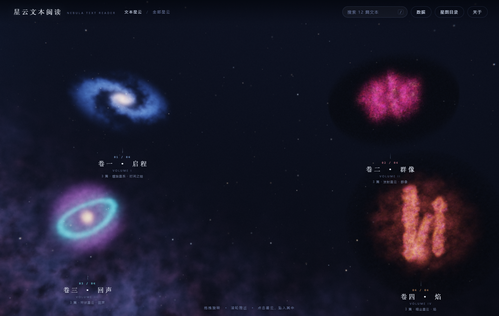

# 星云文本阅读
### NEBULA TEXT READER

> 把你的文本，变成一片可以走进的星云。

一个**零依赖**的本地 Web 阅读器：入口处悬浮着若干片**实时体积星云**（Ray-marched Volumetric Projection，
没有任何贴图），点进去，每一篇文档都是一颗可以点亮、可以悬停看标题、可以点开阅读的恒星。

本仓库**只开源可视化程序本身**，不包含任何第三方剧情文本。你需要导入自己的 `.txt` 目录、
JSON 数据包，或填写自己的远程数据地址。



---

## 特性

- **真 3D 体积星云**：天空、星云、尘埃全部由着色器逐帧积分生成，没有一张位图贴图；
- **文档即星辰**：一篇文本一颗恒星，大小与字数相关，颜色来自所属星云的色谱；
- **悬停看标题**：高亮环 + 贴星卡片，显示篇名、节数、字数；
- **沉浸阅读器**：章节导航、字号调节、`←` `→` 翻章、滚轮/滚动条；
- **数据自由**：本地文件夹 / JSON 数据包 / 远程地址三种导入方式，导入后写入 IndexedDB，下次自动恢复；
- **星云可配置**：片数、形态、位置、颜色、倾角、自转都写在 `js/config.js` 里，新增一片大星云只需追加一段配置；
- **零依赖**：不用框架、不用打包、不用联网；一个静态目录即可运行。

---

## 快速开始

1. 双击 **`星云文本阅读.lnk`**（无地址栏的应用窗口）；
   若被系统拦截，双击 **`启动星云文本阅读.bat`** 用默认浏览器打开。
2. 首次打开显示的是**示例数据**（12 篇原创短篇）。
3. **点击右上角「数据」**，导入你自己的文本文件夹（`.txt`），或载入 JSON / 远程地址。
4. 关闭后再次打开，会自动恢复上次导入的数据。

> 环境要求：Windows / macOS / Linux + Chrome 或 Edge（需要 WebGL2）。
> 直接双击 `index.html` 也能用，只是没有应用窗口。

### 手机上使用（PWA）

把整个目录放到任意 HTTPS 静态托管上（GitHub Pages 即可），或者本地跑 `node tools/serve.js 8099`：

- **Android Chrome / Edge**：菜单 →「添加到主屏幕」
- **iOS Safari**：分享 →「添加到主屏幕」

从主屏幕图标启动就是全屏、无地址栏；首次加载后 Service Worker 会缓存外壳，**断网也能打开**。

### Android APK

仓库里带了一个极简 WebView 外壳（`android/`）和对应的 CI 工作流：

- 从 Releases 下载 `NebulaTextReader-v1.0.0.apk`，安装后打开即可；
- 正式签名（v1 + v2，独立密钥库），安装时需要允许「安装未知应用」；
- 手机上没有「选择文件夹」，用「数据」→「选择 txt 文件（手机）」多选导入；
- 自己构建：`cd android && gradle assembleDebug`（需要 JDK 17 + Android SDK 34）；
- 每次推送 `v*` 标签或手动触发 `android-apk` 工作流都会重新产出 APK。
手机导入文本：右上角「数据」→「选择 txt 文件（手机）」，可一次多选；分组按文件名前缀匹配 `js/config.js` 里的 `match`。

---

## 数据从哪来

程序不内置剧情文本。三种方式任选：

| 方式 | 说明 |
| --- | --- |
| 选择文件夹 | 选中一个目录，其中**每个子文件夹 = 一片大星云**，`.txt` 文件 = 恒星 |
| JSON 数据包 | 见 [教程.md](教程.md) 第 3.2 节的字段说明 |
| 远程地址 | 填写一个返回同结构 JSON 的 URL（需对方允许 CORS） |

导入后写入浏览器 IndexedDB；点「清除已导入」可回到示例数据。

---

## 目录结构

```
星云文本阅读/
├─ 星云文本阅读.lnk        ← 启动快捷方式
├─ 启动星云文本阅读.bat    ← 备用启动器
├─ index.html              ← 应用入口
├─ 教程.md                 ← 使用 / 数据格式 / 二次开发（含「新增一片大星云」）
├─ LICENSE                 ← MIT
├─ css/app.css
├─ js/
│  ├─ config.js            ← 应用名 + 星云配置（改这里就能加星云）
│  ├─ importer.js          ← 文本解析、数据导入、IndexedDB
│  ├─ gl.js                ← WebGL2 工具与矩阵
│  ├─ shaders.js           ← 体积星云 / 星空 / 后处理 GLSL
│  ├─ scene.js             ← 渲染器、相机、拾取、转场
│  ├─ ui.js                ← 名签、搜索、星图、阅读器、数据面板
│  └─ app.js               ← 启动流程与主循环
├─ data/
│  ├─ noise.js             ← 64³ 体积噪声（构建好的贴图数据，非剧情文本）
│  └─ demo.js              ← 12 篇示例短篇（原创）
├─ assets/icon.ico|png
├─ screenshots/
└─ tools/                  ← 构建/调试脚本（可选）
```

---

## 二次开发

- **加一片大星云**：编辑 `js/config.js` 的 `nebulae` 数组，追加一项即可。完整字段说明与示例见
  [教程.md 第 6 节](教程.md#6-如何新加一片外面的大星云)。
- **改星云形态**：`type` 取 0–3（螺旋星系 / 发射星云 / 环状星云 / 暗尘柱状）；想写全新形态，
  在 `js/shaders.js` 里加一个 `medXxx()` 并在 `medium()` 中分派。
- **改星体布局**：`js/scene.js` 的 `buildStars()` 里按 `type` 分支，可以照抄一种再改。
- **改配色**：每片星云的 `accent` 是 RGB(0–1)，`accentCss` 是同色的十六进制，用于界面点缀。

---

## 许可

代码以 **MIT** 协议开源（见 [LICENSE](LICENSE)）。
程序不附带任何第三方文本；使用者导入的内容由使用者自行负责，请确保你拥有相应的阅读与使用权利。
